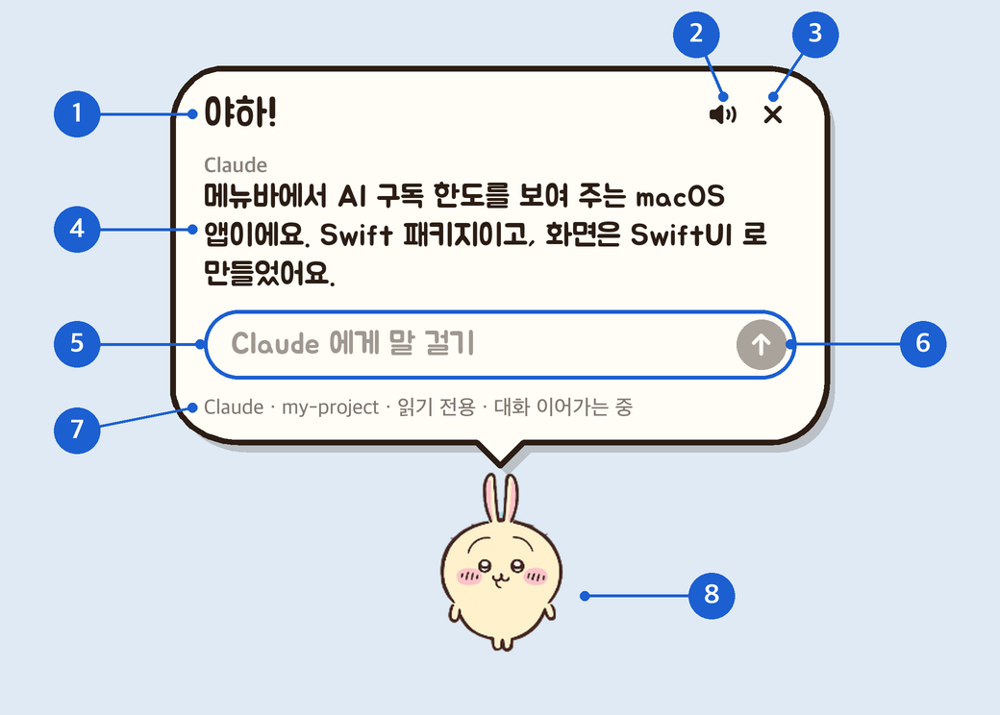

<div align="center">


# Chiikawa in my Mac

### macOS 데스크톱 치이카와 펫

우사기한테 물어보면 대답해줌. 사실 쓸모없음 그냥 귀여움.

<a href="https://github.com/jheroorehj/Chiikawa_in_myMac/releases/latest/download/Chiikawa_in_myMac.dmg"></a>


[어떤 앱인가요](#어떤-앱인가요) · [설치](#설치) · [사용법](#사용법) · [우사기 말](#우사기-말) · [동작 모음](#동작-모음) · [자주 묻는 질문](#자주-묻는-질문)

<br>


</div>

<br>

## 어떤 앱인가요

터미널을 열고, 폴더로 이동하고, AI 를 실행해서 묻는 일을 **우사기를 한 번 누르는 것**으로 줄였습니다.

- **펫에게 묻는 것이 곧 AI 에게 묻는 것** — 우사기 머리 위 말풍선에 질문을 적으면, 내 Mac 에 설치된 Claude 나 Codex 가 대신 답합니다.
- **내 폴더를 보고 답합니다** — 처음에 고른 작업 폴더 안의 파일을 AI 가 읽습니다. "이 폴더 뭐 하는 프로젝트야?" 같은 질문이 통합니다.
- **대화가 이어집니다** — 앱을 껐다 켜도 앞에서 한 이야기를 기억합니다.
- **기다리는 동안 심심하지 않습니다** — 질문을 보내면 폴짝 뛰고, 답이 오면 물구나무를 서고, 혼자 둘 때는 노래도 부릅니다.

우사기는 사람 말을 하지 않습니다. "우나!", "야하!" 같은 우사기 말만 하고, **AI 의 답만 사람 말 그대로** 말풍선에 보여 줍니다.

<br>

## 설치

### 준비물

| 필요한 것 | 설명 |
| --- | --- |
| macOS 14 이상 | |
| Claude Code 또는 Codex | 터미널에서 `claude` 나 `codex` 가 실행되고, **로그인까지 끝난 상태**여야 합니다. 우사기는 이 프로그램을 대신 실행해 줄 뿐입니다. |

### 내려받아 설치하기

<a href="https://github.com/jheroorehj/Chiikawa_in_myMac/releases/latest/download/Chiikawa_in_myMac.dmg"></a>

1. 위 버튼을 눌러 `Chiikawa_in_myMac.dmg` 를 내려받습니다. 항상 최신 버전입니다.
2. 받은 파일을 열고 Chiikawa_in_myMac 을 **Applications** 폴더로 끌어다 놓습니다.
3. 응용 프로그램 폴더에서 Chiikawa_in_myMac 을 엽니다.

Apple Silicon 과 Intel Mac 모두에서 실행됩니다.

<details>
<summary><b>"열 수 없습니다" 또는 "손상되었습니다" 라는 창이 뜬다면</b></summary>

<br>

앱이 고장 난 것이 아닙니다. Apple 에 등록하지 않은 앱을 처음 열 때 Mac 이 한 번 막는 것입니다. 아래 둘 중 하나를 한 번만 하면 됩니다.

- **시스템 설정 → 개인정보 보호 및 보안** 을 열고 아래쪽의 **그래도 열기** 를 누릅니다.
- 또는 터미널에 아래 한 줄을 붙여 넣고 Enter 를 누른 뒤 앱을 다시 엽니다.
  ```bash
  xattr -dr com.apple.quarantine /Applications/Chiikawa_in_myMac.app
  ```

</details>

### 직접 빌드해서 설치하기

Xcode (Swift 6) 가 필요합니다. 터미널에서 이 폴더로 이동한 뒤 아래 한 줄을 실행합니다.

```bash
./scripts/build-app.sh --install
```

`응용 프로그램` 폴더에 **Chiikawa_in_myMac** 이 생깁니다. 두 번 눌러 엽니다.

### 처음 켜기

1. 폴더를 고르는 창이 뜹니다. **AI 가 읽을 폴더**를 고르고 `이 폴더에서 작업`을 누릅니다.
2. 화면 구석에 우사기가 나타나고 말풍선이 열립니다.
3. 메뉴바에 우사기 아이콘  이 생깁니다. Dock 에는 아이콘이 생기지 않습니다.

<br>

## 사용법

### 1. 우사기에게 말 걸기

우사기를 **한 번 누르면** 말풍선이 열립니다. 질문을 적고 `return` 을 누르면 끝입니다.

<div align="center">

</div>

| 번호 | 이름 | 하는 일 |
| :---: | --- | --- |
| ① | 우사기 말 | 지금 우사기의 기분입니다. 질문을 보내면 "우나!", 답이 오면 "야하!" 로 바뀝니다. |
| ② | 소리 버튼 | 우사기 목소리를 끄고 켭니다. |
| ③ | 닫기 | 말풍선을 닫습니다. `esc` 키도 같습니다. |
| ④ | AI 의 답 | 가장 마지막 답이 보입니다. 길면 이 안에서 스크롤됩니다. 글자를 끌어서 복사할 수 있습니다. |
| ⑤ | 입력란 | 여기에 질문을 적습니다. |
| ⑥ | 보내기 | 질문을 보냅니다. 답을 기다리는 동안에는 ■ 모양의 **멈추기** 버튼으로 바뀝니다. |
| ⑦ | 상태 줄 | 지금 누구와(Claude · Codex), 어느 폴더에서, 어떤 권한으로 대화하는지 보여 줍니다. |
| ⑧ | 우사기 | 누르면 말풍선이 열리고 닫힙니다. **끌면 옮겨지고**, 마우스 오른쪽 버튼을 누르면 메뉴가 나옵니다. |

### 2. 답이 올 때까지

| 순서 | 우사기 | 화면에 보이는 것 |
| :---: | --- | --- |
| 질문을 보냄 | "우나!" 하며 폴짝 뜁니다 | `Claude 에게 물어보는 중…` |
| 답이 옴 | "야하!" 하며 물구나무를 섭니다 | 말풍선에 AI 의 답 |
| 잘 안 됨 | "후와~망…" 하며 시무룩해집니다 | 빨간 글씨로 무엇이 잘못됐는지 |
| 멈춤 | "하?" 하며 팔짱을 낍니다 | 질문이 취소됩니다 |

### 3. 메뉴

메뉴바의 우사기 아이콘을 누르거나, 우사기를 **마우스 오른쪽 버튼**으로 누르면 나옵니다.

| 메뉴 | 하는 일 |
| --- | --- |
| 말풍선 열기/닫기 | 우사기를 누르는 것과 같습니다. |
| 새 대화 (세션 초기화) | 지금까지 한 이야기를 잊고 처음부터 시작합니다. |
| Claude 와 대화 · Codex 와 대화 | 답해 줄 AI 를 고릅니다. |
| 읽기 전용 · 파일 수정 허용 | AI 가 폴더의 파일을 **읽기만** 할지, **고칠 수도** 있게 할지 정합니다. 처음에는 읽기 전용입니다. |
| 우사기 말 뜻 보기 | 우사기 말 아래에 뜻을 함께 보여 줍니다. |
| 우사기 말 모두 보기… | 우사기가 하는 모든 말을 모아 둔 사전을 엽니다. |
| 혼잣말 하기 | 가만히 둘 때 가끔 혼자 중얼거리게 합니다. |
| 음소거 | 우사기 목소리를 끕니다. |
| 작업 폴더 바꾸기… | AI 가 읽을 폴더를 다른 곳으로 바꿉니다. |
| Finder 에서 작업 폴더 열기 | 지금 폴더를 Finder 로 엽니다. |
| 펫을 화면 구석으로 데려오기 | 우사기가 안 보일 때 화면 구석으로 불러옵니다. |
| 다시 시작 | 앱을 껐다 다시 켭니다. |
| 우사기 종료 | 앱을 끕니다. |

<br>

## 우사기 말

우사기 말이 무슨 뜻인지 궁금하면 메뉴에서 **우사기 말 뜻 보기**를 켭니다. 말 아래에 작은 괄호로 뜻이 붙습니다.

말풍선은 상황에 따라 아홉 가지 모양으로 바뀝니다. 아래는 뜻 보기를 켰을 때의 모습입니다.

<div align="center">

</div>

**우사기 말 모두 보기…** 를 누르면 사전이 열립니다. 줄을 누르면 우사기가 그 말을 직접 해 보이고, 🔈 표시가 있는 말은 소리도 납니다.

### 혼잣말

말풍선을 닫아 두면 우사기가 4~10분에 한 번씩 혼자 중얼거립니다. 잠깐 떴다가 저절로 사라집니다.

- 평소에는 신나서 외치거나, 갸웃하거나, 노래를 부릅니다.
- 점심·저녁 때에는 "쥬르리" 하며 배고파합니다. `간식 주기`를 눌러 줄 수 있습니다.
- 밤 11시부터 새벽 5시까지는 "구우구우~" 하고 잠만 잡니다.

방해가 되면 메뉴에서 **혼잣말 하기**를 끕니다.

<br>

## 동작 모음

우사기는 상황마다 다르게 움직입니다. 아래는 앱에 들어 있는 그림 그대로입니다.

<table>
  <tr>
    <td align="center"><br><b>엎드려 쉬기</b><br><sub>가만히 있을 때</sub></td>
    <td align="center"><br><b>뒤돌아보기</b><br><sub>말풍선을 열어 둔 동안</sub></td>
    <td align="center"><br><b>폴짝</b><br><sub>"우나!" 질문을 보냄</sub></td>
    <td align="center"><br><b>물구나무</b><br><sub>"야하!" 답이 옴</sub></td>
  </tr>
  <tr>
    <td align="center"><br><b>팔짱</b><br><sub>"하?" 멈춤</sub></td>
    <td align="center"><br><b>프로펠러로 날기</b><br><sub>끌어서 옮길 때</sub></td>
    <td align="center"><br><b>손 모으기</b><br><sub>켤 때 인사</sub></td>
    <td align="center"><br><b>응원</b><br><sub>"푸루야" 힘내!</sub></td>
  </tr>
  <tr>
    <td align="center"><br><b>꼬리 흔들기</b><br><sub>"후웅?" 혼잣말</sub></td>
    <td align="center"><br><b>선글라스</b><br><sub>"우~라~" 혼잣말</sub></td>
    <td align="center"><br><b>빛 뿜기</b><br><sub>"이~" 혼잣말</sub></td>
    <td align="center"><br><b>노래와 춤</b><br><sub>노래 혼잣말</sub></td>
  </tr>
</table>

<br>

## 자주 묻는 질문

<details>
<summary><b>말을 걸었는데 "CLI 를 찾을 수 없습니다" 라고 나와요</b></summary>

<br>

고른 AI 의 프로그램이 Mac 에 없거나 로그인이 안 된 상태입니다. 터미널에서 `claude` (또는 `codex`) 를 실행해 로그인까지 마친 뒤 다시 물어보세요.

</details>

<details>
<summary><b>AI 가 내 파일을 마음대로 고치나요?</b></summary>

<br>

처음에는 **읽기 전용**이라 고치지 못합니다. 메뉴에서 `파일 수정 허용`을 골랐을 때만, 작업 폴더 안의 파일을 고칠 수 있습니다.

</details>

<details>
<summary><b>앞에서 한 대화를 다시 볼 수 있나요?</b></summary>

<br>

말풍선에는 가장 마지막 답만 보입니다. 전체 기록은 작업 폴더의 `.chiikawa_in_mymac/session.json` 파일에 남습니다.

</details>

<details>
<summary><b>우사기가 화면에서 사라졌어요</b></summary>

<br>

메뉴바의 우사기 아이콘을 누르고 `펫을 화면 구석으로 데려오기`를 고릅니다.

</details>

<details>
<summary><b>Claude 에 걸어 둔 훅이나 외부 도구(MCP)가 안 돌아요</b></summary>

<br>

이 앱은 Claude 를 부를 때 사용자가 걸어 둔 훅과 MCP 서버를 건너뜁니다. 훅 때문에 답이 끝내 오지 않던 일이 있어서 그렇게 했습니다.

</details>

<details>
<summary><b>Gemini 나 Grok 은 못 쓰나요?</b></summary>

<br>

지금은 Claude 와 Codex 만 고를 수 있습니다.

</details>

<br>

## 개인정보

- 우사기는 내 Mac 에 설치된 `claude` · `codex` 를 **실행만** 합니다. 이 프로그램들의 로그인 정보를 읽거나 고치지 않습니다.
- 질문과 답은 그 AI 프로그램이 평소 하던 대로 해당 서비스와 주고받습니다. 이 앱이 따로 모으거나 다른 곳으로 보내는 것은 없습니다.
- 대화 기록은 작업 폴더의 `.chiikawa_in_mymac/session.json` 에, 앱 설정은 `~/.config/chiikawa_in_mymac/config.json` 에만 저장됩니다.

<br>

## 개발

<details>
<summary><b>빌드 · 테스트 · 구조</b></summary>

<br>

```bash
swift build                       # 빌드
swift test                        # 테스트
./scripts/build-app.sh            # build/Chiikawa_in_myMac.app 만들기
./scripts/build-app.sh --install  # 응용 프로그램 폴더에 설치까지
```

| 위치 | 내용 |
| --- | --- |
| `Sources/Chiikawa_in_myMacCore/` | AI 프로그램 실행, 출력 해석, 대화 저장 (Foundation 만 사용) |
| `Sources/Chiikawa_in_myMac/` | 펫, 말풍선, 메뉴 (AppKit · SwiftUI) |
| `Resources/Pets/usagi/` | 우사기 그림. Codex Pets 형식의 시트(`pet.json` + 8칸 × 11줄)와 동작별 그림 |
| `Resources/Voices/` | 우사기 목소리 |
| `scripts/` | 앱 묶음 만들기, 아이콘 · 동작 그림 만들기 |

</details>

<br>

## 참고

- 말풍선 글꼴은 [Jua](https://fonts.google.com/specimen/Jua) 입니다 (SIL Open Font License 1.1, Copyright 2018 The BM JUA Project Authors).
- 펫 그림 묶음은 Codex Pets 의 시트 형식을 따릅니다.

<br>

## 저작권

**이 앱은 팬이 만든 비공식 프로그램입니다. 원작자 · 권리자와 아무 관련이 없고, 승인이나 후원을 받지 않았습니다.**

- 「치이카와」(ちいかわ)와 우사기를 비롯한 모든 캐릭터, 그 이름 · 그림 · 목소리의 저작권과 상표권은 원작자 나가노(ナガノ)와 각 권리자에게 있습니다. © nagano / chiikawa committee
- 이 저장소와 앱에 들어 있는 캐릭터 그림(아이콘, 펫 그림, 동작 그림)과 음성은 원작에서 가져왔거나 원작을 바탕으로 만든 것입니다. 만든 사람은 이것들에 대해 어떤 권리도 주장하지 않으며, 다시 쓰거나 나눌 권리를 누구에게도 줄 수 없습니다.
- 돈을 받지 않고, 광고도 없습니다. 이 앱이나 그 안의 그림 · 음성을 팔거나 돈을 버는 데 쓰지 마세요.
- 권리자가 요청하면 해당 그림 · 음성 또는 이 저장소 전체를 바로 내리겠습니다. 이 저장소의 Issues 로 알려 주세요.
